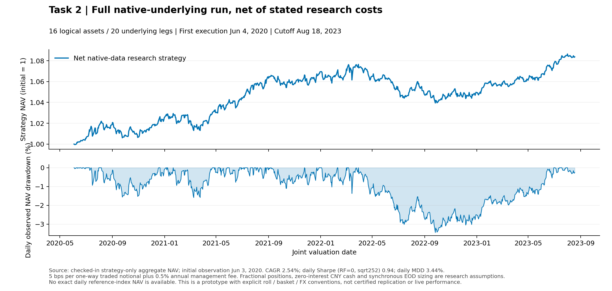

# Factor and Trend Strategy Research

Two systematic-investing research projects covering cross-sectional A-share stock ranking and multi-asset trend allocation. The emphasis is on time-based validation, portfolio construction, risk diagnostics and explicit return accounting.

The repository extends earlier internship prototypes with subsequent independent research. It includes portable code, synthetic demonstrations, tests and aggregate results from the evaluated historical runs. See [research scope and chronology](docs/research_scope.md) for the distinction between the original tasks and their extensions.

## Research projects

### Task 1 — Factor-based A-share stock selection

**Question:** can fundamental and price-volume signals rank next-period stock returns, and how does that ranking translate into a portfolio after costs?

- Original 2005–2018 monthly panel: 70 candidate factors, about 320,000 stock-month observations and 3,540 distinct stocks across the full history.
- Ridge regression compared with L2 logistic regression and LightGBM classifiers. Classifiers learn the monthly top/bottom 30% tails; Ridge uses continuous benchmark-relative returns.
- Training-window preprocessing, correlation screening, expanding-window validation and annual expanding refits.
- Monthly long-only portfolios, stock-count and weighting comparisons, turnover-cost sensitivity, market-state overlays and China Fama–French attribution.
- Published-as-of historical CSRC industry classifications for a separate industry-adjusted ranking check.

The LightGBM model's mean monthly Rank IC was **0.1399 across 49 historical evaluation months**. On the identical classified sample, its raw IC was **0.1402**, versus **0.1399 after demeaning both scores and forward returns by industry**. These are ranking correlations, not prediction accuracy or portfolio returns.


[Methodology](docs/task1_methodology.md) · [Historical results](results/task1/) · [Portfolio tradeoffs](docs/figures/task1_portfolio_tradeoffs.png)

### Task 2 — Multi-asset trend allocation

**Question:** how can trend and early-recovery rules be translated into risk-aware allocations with causal timing and consistent native-instrument accounting?

- Sixteen logical equity, government-bond and commodity exposures, implemented through twenty funded-index or futures legs in the native research run.
- Trend rankings, a moving-average recovery rule, volatility-aware sizing, asset caps and staggered monthly execution.
- Separate funded principal and futures variation margin, explicit contract rolls, FX marks, turnover costs and management-fee accrual.
- A synthetic native-instrument demonstration that exercises the engine without distributing the historical source quotes.

The evaluated native run executed from **2020-06-04 to 2023-08-18**, after the required history became available. It reported net CAGR **2.54%**, daily Sharpe **0.938** under its stated zero-RF convention, and daily NAV maximum drawdown **3.44%**. Its low gross exposure and cash assumptions matter when interpreting these results.



[Methodology](docs/task2_methodology.md) · [Historical results](results/task2/)

## Quick start

Python 3.11 or later is required; the CI workflow uses Python 3.12.

```bash
python -m venv .venv
source .venv/bin/activate
python -m pip install -e ".[research,dev]"

# Both commands generate explicitly synthetic demonstrations.
python -m factor_trend_research.task1 --demo --output outputs/task1_demo
python -m factor_trend_research.task2 --demo --output outputs/task2_demo

python -m pytest
```

On Windows, activate the environment with `.venv\Scripts\activate` instead. LightGBM is optional for the base installation and is included in the `research` extra; an unavailable requested model is not silently replaced with a different estimator.

On macOS, LightGBM also needs an OpenMP runtime; see the [platform guidance](docs/task1_methodology.md#run-it). The directly tested package versions are recorded in [requirements-tested.txt](requirements-tested.txt). These versions describe this public software release, rather than asserting that every earlier experiment used identical dependencies.

## Local data and historical results

Raw equity factors, stock-level predictions and holdings, source market quotes, vendor files and internal reference documents are not bundled. [Data access](docs/data_access.md) and the [data dictionary](docs/data_dictionary.md) describe the required local inputs and external sources.

```bash
python -m factor_trend_research.task1 --help
python -m factor_trend_research.task2 --help
```

The files under `results/` are aggregate outputs from the evaluated historical research. Running a synthetic demo writes new outputs under `outputs/`; it does not reproduce or overwrite those historical results. Read the [results guide](docs/results_guide.md) before comparing return, drawdown and attribution figures.

`tests/test_published_results.py` independently reconciles the checked-in NAVs, returns, costs, catalog joins and metric identities without loading any underlying stock-level or market data. The method documents distinguish directly executable workflows from the earlier experiments represented by the aggregate catalog.

Same-input historical correspondence checks are recorded for [Task 1](results/task1/portable_code_verification.json) and [Task 2](results/task2/portable_code_verification.json). They bind the tested public modules to their source hashes and describe the exact comparison scope; the underlying historical inputs remain private.

The [publication manifest](results/manifest.json) records the checksums of the aggregate exports, configurations and figures in this release.

## Repository structure

```text
src/factor_trend_research/
  task1/                 Equity data, models, validation and portfolio diagnostics
  task2/                 Trend rules, native instruments and portfolio accounting
configs/                 Declared research settings
tests/                   Timing, data alignment, selection and accounting checks
docs/                    Methods, data definitions, interpretation and figures
results/task1/           Aggregate equity research outputs
results/task2/           Aggregate native trend-research outputs
legacy/                  Earlier scripts retained as historical references
```

## Interpretation

Task 1 absolute NAV is reconstructed from the supplied arithmetic benchmark-relative return field and CSI300 returns over the same holding dates. Its drawdown is observed at monthly holding boundaries, and its transaction costs are a target-turnover approximation. The historical evaluation period has been inspected repeatedly, so it is not a fresh untouched holdout.

Task 2 uses research conventions for cash, collateral, fractional quantities, rolls, calendars and FX observation timing. It is not a live execution record. Its daily drawdown cannot be compared directly with Task 1's monthly-observation drawdown, and the two Sharpe ratios use different sampling and risk-free conventions.
