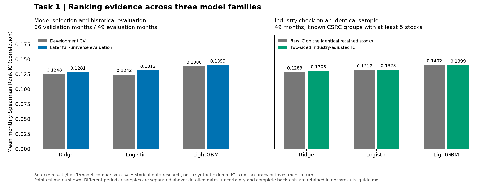
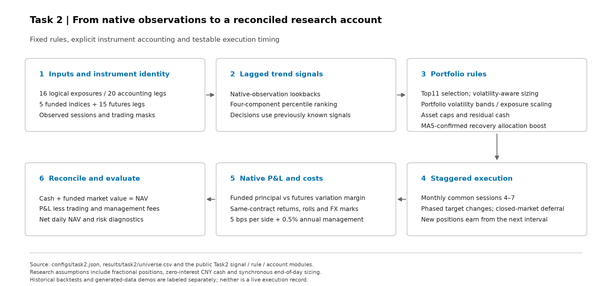

# Factor and Trend Strategy Research

Python research pipelines for cross-sectional stock ranking and multi-asset trend allocation. The projects connect data validation, chronological experiments, statistical evidence and portfolio implementation.

[Full results and backtests](results/README.md) · [Research design](docs/research_scope.md) · [Data and reproducibility](docs/data_access.md)

## Task 1 — Multi-factor A-share stock selection

**Research question:** can fundamental and price-volume factors rank next-period stock returns, and does that association remain after accounting for industry effects?

The panel contains **70 candidate factors, 162 signal months, 319,441 stock-month observations and 3,540 stocks across the history**. Ridge regression predicts continuous benchmark-relative returns; Logistic and LightGBM classifiers learn the strongest and weakest monthly return tails.

The research workflow is:

1. Validate stock–month keys, eligibility, missing values and forward-return alignment.
2. Fit imputation, scaling and correlation-based feature screening inside each training window.
3. Compare 18 model configurations over **66 expanding-window validation months** using full-universe monthly Rank IC.
4. Evaluate frozen hyperparameters with annual expanding refits over **49 later historical months**.
5. Check industry-adjusted ranking, statistical uncertainty, portfolio concentration, turnover costs and factor exposures.

**Main evidence:** LightGBM was selected by development-validation Rank IC. Its mean evaluation Rank IC was **0.1399**. On the identical industry-classified sample, raw IC was **0.1402**, compared with **0.1399 after industry adjustment**. This measures ranking association; a tail-trained classifier supplies a ranking score, rather than a calibrated unconditional event probability.



The portfolio analysis compares stock counts, weights and market-state rules. Stronger full-universe ranking did not consistently produce lower concentrated-portfolio risk. [Complete portfolio returns, drawdowns, costs and attribution](results/README.md#task-1--stock-ranking-and-portfolio-results) are retained with the method definitions.

[Task 1 methodology](docs/task1_methodology.md) · [Model comparison data](results/task1/model_comparison.csv) · [Code](src/factor_trend_research/task1/)

## Task 2 — Multi-asset trend allocation

**Research question:** how can research-report-based trend and recovery rules become a consistent allocation, execution and P&L process?

The strategy covers **16 logical exposures and 20 underlying legs** across equity indices, government-bond futures and commodities. Four trend indicators rank assets for Top11 selection. Volatility-based sizing, asset caps and an **MA5-confirmed recovery rule** shape target weights, followed by staggered execution and portfolio volatility controls.

The implementation separates funded-index principal from futures variation margin, handles contract rolls and FX marks, and reconciles trading costs, management fees, cash and NAV.



[Task 2 methodology](docs/task2_methodology.md) · [Full net backtest, NAV and drawdown](results/README.md#task-2--native-multi-asset-backtest) · [Code](src/factor_trend_research/task2/)

## Read and reproduce the evidence

**The statistical figure above and the backtest charts on the results page use historical research outputs.** They are hypothetical backtests, not live investment performance. The workflow diagram describes the implemented process.

The [results page](results/README.md) includes complete metrics, NAV and drawdown figures, portfolio comparisons, costs, factor attribution and limitations. Exact data windows and chronology are documented in the methods and configurations. The evaluated history has been examined repeatedly and is not a fresh untouched holdout.

Python 3.11 or later is supported. Install the tested dependencies, regenerate the figures from the public aggregates and declared configuration, and check the research outputs:

```bash
python -m venv .venv
source .venv/bin/activate
python -m pip install -r requirements-tested.txt -e ".[research,dev]"
python docs/figures/regenerate.py
python -m pytest
```

On Windows, activate with `.venv\Scripts\activate`. LightGBM is optional in the base package; macOS also requires its OpenMP runtime. See the [installation guidance](docs/task1_methodology.md#run-it).

### Research with local inputs

The [data guide](docs/data_access.md) defines the local factor-panel, matched benchmark and native-instrument interfaces. Reproducing the historical training and backtests requires the same source inputs and declared conventions. Original panels, quotes, stock-level predictions and holdings, vendor files and internal documents are excluded from this repository.

```bash
python -m factor_trend_research.task1 --help
python -m factor_trend_research.task2 --help
```

### Optional synthetic software checks

These commands generate separate artificial inputs to exercise the software when the private historical data is unavailable. Their output is **not used in the published historical charts or performance metrics**.

```bash
python -m factor_trend_research.task1 --demo --output outputs/task1_demo
python -m factor_trend_research.task2 --demo --output outputs/task2_demo
```

Local outputs remain under the ignored `outputs/` directory. The same-input historical correspondence records for [Task 1](results/task1/portable_code_verification.json) and [Task 2](results/task2/portable_code_verification.json), and the [publication manifest](results/manifest.json), connect the public implementation with the checked research outputs.

## Repository map

- `src/factor_trend_research/`: model, validation, portfolio, signal and accounting modules.
- `configs/`: declared model and strategy settings.
- `results/`: complete aggregate historical results and verification records.
- `docs/`: methodology, data definitions and reproducible figures.
- `tests/`: timing, matching, selection, accounting and published-result checks.
- `legacy/`: archived implementation versions.
