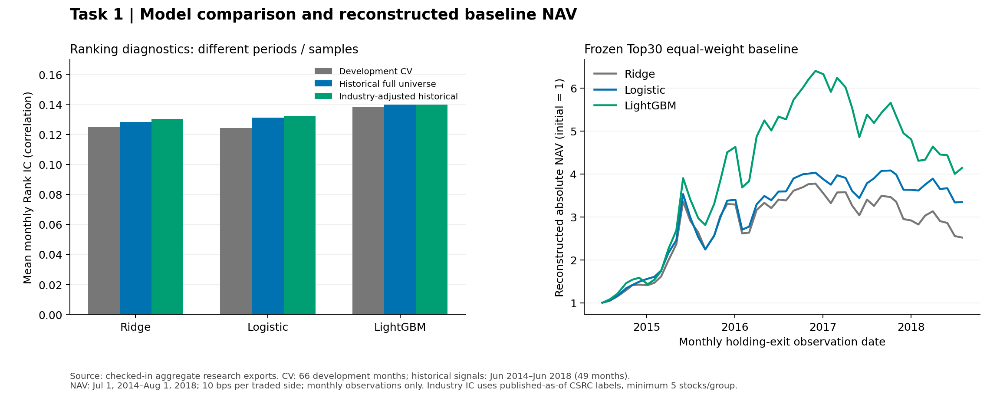
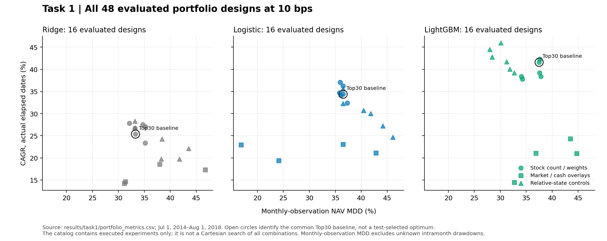
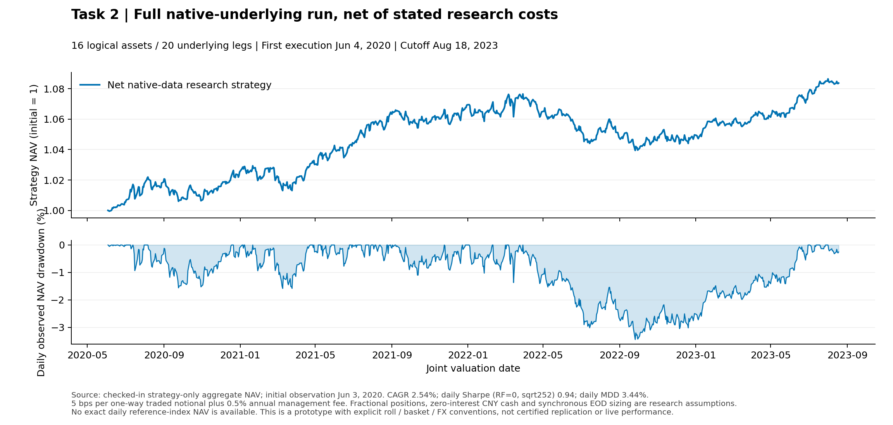

# Guide to the historical result exports

The `results/` directory contains aggregate outputs from completed historical research. These are separate from synthetic examples produced by the public demo. Running a demo does not reproduce the private historical inputs or certify the published performance.

The project comprises a three-model equity-factor comparison with chronological validation, portfolio controls, risk attribution and industry diagnostics, together with a native-underlying multi-asset strategy and explicit account simulation. The exports document the declared configurations, evaluation windows and validated calculations.

## How the code, configurations and archived results correspond

The public modules expose the research components; the historical CSVs preserve completed, independently checked runs. Their filenames and presentation schemas differ from a newly generated local run. This checkout does **not** claim one command will regenerate every archived CSV byte for byte.

- **Task 1 model comparison and six stock books:** `configs/task1.json`, `task1/data.py`, `features.py`, `models.py`, `research.py` and `portfolio.py` define the matching data treatment, grids, chronological folds, annual refits, Top30/50/100 books and fees. The Task 1 CLI directly runs these stages. Historical `cv_leaderboard.csv`, `model_comparison.csv`, baseline NAV/returns and the `stock_book` catalog rows summarize the corresponding evaluated stages.
- **Task 1 market/cash and relative-state policies:** `task1/regimes.py` supplies their exposure/stock-basket helpers; `portfolio.py` accepts the resulting holdings/exposure. The archived `market_overlay` and `relative_state` rows preserve separate frozen development-selection experiments. They are not automatically searched or selected by the core CLI, and the full 48-policy catalog is not a Cartesian configuration grid.
- **Task 1 industry adjustment:** `task1/diagnostics.py` provides published-as-of matching, the primary and sensitivity IC definitions, within-industry weighted IC and monthly-mean HAC/block-bootstrap inference. With `--industry-history`, the CLI writes monthly diagnostics for minimum group sizes 5, 2 and 10, the inference summary and primary-sample bootstrap results. Its IC field names match the published industry CSVs; the archive retains the five-stock primary monthly sample in a separate file.
- **Task 1 FF3/FF5:** `task1/diagnostics.py::factor_attribution` implements matched-date OLS/Bartlett-HAC inference. It requires independently prepared factor returns with the correct dates and aggregation convention. The 48-row historical attribution catalog contains the validated regression outputs and publication formatting; the CLI does not download factors or automatically create that catalog.
- **Task 2 native engine:** `configs/task2.json`, `task2/native_signals.py`, `rules.py`, `native_strategy.py`, `native_engine.py` and `future_accounting.py` implement the declared rule and account path; `inputs.py` validates prepared caller-owned inputs. `runner.py` writes a fresh ledger and summary. An actual local historical-core rerun using the same approved precomputed signals and native accounting inputs matched all 836 daily observations and both performance windows. The [sanitized verification record](../results/task2/portable_code_verification.json) records 96 checks and the verified module hashes. This core check does not assert that the general raw-input CLI, an altered warm-up or arbitrary replacement inputs will reconstruct the canonical signal cache.
- **Figures:** `docs/figures/regenerate.py` builds the statistical/backtest charts from the checked-in aggregate CSVs and the workflow diagram from the declared strategy configuration. It neither trains a model nor substitutes generated prices for the historical record.

Local real-data runs can write individual predictions, holdings, positions and trades to the requested `outputs/` directory, which is ignored by Git. Those local outputs are **not** the publication allowlist; do not copy them into `results/` when using private or licensed inputs.

The [Task 1 historical correspondence record](../results/task1/portable_code_verification.json) verifies the public modules against the same local historical inputs: all 18 CV configurations, 382,953 model-stock-month predictions, 192 portfolio/fee cases, 96 factor regressions and the industry diagnostics matched within the recorded numerical tolerances. This verifies the implemented calculations; it does not add the private datasets or the archived nested development-selection orchestration to the public CLI. Tests also check that the verified public source/configuration hashes still match the committed files.

## Task 1: what to read first

Start with `results/task1/model_comparison.csv`, then inspect `portfolio_metrics.csv` and `factor_attribution.csv`. The first file joins the frozen development choice with evaluation-period diagnostics; it does not select a model using historical portfolio profit.

The inputs comprise 70 supplied factors, including fundamental and price/volume variables, over 162 signal months from January 2005 to June 2018. The eligible panel has 319,441 stock-month rows and 3,540 distinct stock codes. The private stock-level panel is not published.

The common protocol was:

1. Fit the imputer and scaler using historical training observations only. The supplied factor values already appeared processed, so the configured pipeline did not apply an additional MAD-clipping pass.
2. Recompute correlation screening in each training window. The screen uses median monthly absolute Spearman correlation at a 0.90 threshold and retains a representative using historical training IC.
3. Compare Ridge on continuous forward relative returns with L2 Logistic and LightGBM on monthly top/bottom 30% return tails. Score the full eligible universe. A classifier trained on the tails supplies a ranking score, not a calibrated unconditional top-30% probability.
4. Select configurations and the model family using mean full-universe monthly Rank IC across the same 66 chronological development-validation months. The three expanding folds are recorded in `summary.json`. No random stock-month split was used.
5. Evaluate annual expanding-window refits on 49 evaluation signal months, June 2014–June 2018. Model training outcomes must already be known before a prediction. This history had previously been inspected; chronological separation does not make it a new untouched holdout.

LightGBM was the development-selected family. The selected development mean Rank IC was approximately 0.1380, versus 0.1248 for Ridge and 0.1242 for Logistic. Full-universe historical mean Rank IC was approximately 0.1399, 0.1281 and 0.1312 respectively. The ranking diagnostics should be considered together with portfolio concentration, risk exposure and uncertainty.

## Absolute return reconstruction and timing

The supplied target is interpreted as an arithmetic difference: the stock's next holding-period return minus the CSI300 return over the same dates. The absolute-return calculation reconstructs a fully invested stock basket's return by adding the same-period official CSI300 **price** return. It does not compound the relative-return difference as if it were a self-financing wealth return.

The primary holding interval is the first trading-day **close** of month `t+1` to the first trading-day **close** of `t+2`, for signal month `t`. The 49 intervals run from July 1, 2014 to August 1, 2018. They are not natural month-end-to-month-end intervals. The reconstruction is supported by historical price matching, but does not certify the original vendor's release vintages or executable fills.

For the Top30 equal-weight baseline at 10 bps per traded side, the reconstructed results are approximately:

- LightGBM: CAGR **41.59%**, Sharpe **0.965**, monthly-observation NAV MDD **37.49%**.
- Logistic: CAGR **34.38%**, Sharpe **0.911**, monthly-observation NAV MDD **36.51%**.
- Ridge: CAGR **25.37%**, Sharpe **0.706**, monthly-observation NAV MDD **33.30%**.

These large historical returns are hypothetical research results over a short, previously studied period. They are not live returns, and the monthly observations cannot reveal daily or intramonth portfolio drawdown. The original processed factors, label definition and execution approximations remain material limits.

`monthly_baseline_nav.csv` contains the three baselines under four fee assumptions, including their initial NAV observations. `monthly_baseline_returns.csv` contains the corresponding strategy-level net and active returns. No individual holdings, predictions or stock returns are included.

## The portfolio catalog is not an optimal-strategy claim

`portfolio_metrics.csv` has **192 rows: 48 unique evaluated configurations × 4 fees** (0, 5, 10 and 20 bps). Each model has 16 configurations:

- Six stock books: Top30/50/100, each equal-weighted or risk-rank-weighted.
- Four common market/cash overlays on the same Top30 equal-weight basket: 10-month moving-average trend, 12-month momentum, market-volatility scaling and trend-plus-volatility scaling.
- Six relative-state controls: always-defensive Top100/200 controls and 6-/12-month state-switching rules with either candidate pool.

The common Top30 baseline appears once, even where it was shared across experiments. The catalog does not contain unrun combinations such as Top100 × a cash overlay × the old relative-state rule.

The `selected_*_development` flags preserve each experiment's original development criterion. They are not flags for the best later return or lowest later MDD. All three model families retained the baseline in the common absolute-return market/cash selection. The relative-state and stock-book selections use different, explicitly recorded objectives; they should not be merged into a new strategy after viewing results.

The risk-rank stock weights use a **processed three-month-volatility factor's cross-sectional rank**, not its numerical value as actual volatility. The common market-volatility overlay instead uses CSI300 63-day realized volatility to set exposure. Its reference 15% level is not a promise that the resulting portfolio realizes 15% volatility.

Costs are `fee_bps / 10000 × sum(abs(current_target_weight − previous_target_weight))`, including first entry, without terminal liquidation. Both purchases and sales contribute. This sensitivity proxy omits holding drift, bid–ask spreads, market impact and trading constraints.

## Factor attribution

`factor_attribution.csv` reports FF3 and FF5 attribution for all 48 configurations, uniformly **net of 10 bps**, with HAC lag 6. The same estimates are joined into the 10-bps rows of `portfolio_metrics.csv`; attribution cells for other fees are blank and explicitly marked as not estimated.

The main factors are classic Chinese A-share FF3/FF5 from the BetaPlus daily data. They are aggregated over the exact holding windows. Compounding daily long–short factor returns is a declared daily-rebalanced proxy, not a claim that it equals a publisher's fixed-leg monthly series. The market factor in this model is not identical to the CSI300 benchmark used elsewhere.

Annual arithmetic alpha is **12 × the monthly OLS intercept**, not CAGR. Its HAC interval is conditional on the chosen factor model, sampling window and research history. Market/SMB/HML/RMW/CMA loadings measure statistical exposure, not portfolio weights. R² explains fitted return **variation**, not the share of profit attributable to a factor or the fraction of skill.

## Industry robustness

The industry files use **CSRC detailed major industries, not the Shenwan industry taxonomy**. Eighteen historical quarterly snapshots, 2013Q4–2018Q1, are joined using the latest snapshot published by each signal-month end. The 2019/current classification is not backfilled into the 2014–2018 evaluation.

The primary sample excludes unknown industries and groups with fewer than five eligible stocks. Mean known-label coverage is about **99.21%**; mean retained coverage after the group-size filter is about **97.85%**. `industry_coverage.csv` records coverage before the small-group exclusion; `industry_monthly_ic.csv` records the retained sample.

The primary adjusted IC subtracts each industry's mean from the raw score and from the raw future return, then computes Spearman correlation of those residuals. Its historical mean is about **0.13986** for LightGBM, **0.13231** for Logistic and **0.13030** for Ridge. Compare it with raw IC on the **same retained stocks**, rather than attributing changes caused by sample exclusion to neutralization.

Two sensitivities answer related but different questions:

- `industry_partial_spearman`: rank both variables first, demean those ranks by industry, then calculate Pearson correlation without reranking the residuals.
- `return_only_group_adjusted_ic`: demean future returns only and correlate them with the original score, following the Alphalens `group_adjust` convention.

`industry_inference.csv` contains monthly-mean HAC6 inference for minimum groups of 2, 5 and 10 stocks. `industry_bootstrap.csv` contains 10,000-draw moving-block confidence intervals for the primary five-stock sample, using blocks of 6 months primarily and 3/12 months as sensitivities. Positive adjusted IC supports a conditional ranking association beyond industry means. It does not prove pure alpha, certify industry-neutral holdings, or change the reported portfolio return or MDD. Quarterly publications can lag real business changes.

## Task 2: native-underlying multi-asset strategy

The completed run covers **16 logical assets and 20 actual underlying legs**. The source search begins in 2018, but that is not the strategy's performance start. All assets first needed the required native-observation warm-up and then the next complete monthly execution phase. Initial NAV is dated June 3, 2020; **first execution is June 4, 2020**; the cutoff is August 18, 2023.

Over the full native window, there are 836 daily return observations:

- Net CAGR: **2.5388%**; cumulative return: **8.3697%**.
- Daily arithmetic Sharpe with RF=0 and the frozen `sqrt(252)` convention: **0.9380**.
- Annualized daily volatility: **2.6197%**.
- Daily observed NAV MDD: **3.4408%**, from March 30 to September 26, 2022.

The net yearly/partial-year returns are +2.5250% for June–December 2020, +4.3082% for 2021, −1.8500% for 2022, and +3.2451% for 2023 through August 18. Partial years are flagged in the CSV. The fixed January 2021–cutoff window is reported separately; it is not substituted for the full run to improve the headline.

The account distinguishes funded equity-index exposures from futures variation margin. Futures notional is not invested principal in NAV. The five equity series are real price indices modeled as funded positions, excluding dividends; they are not relabeled ETFs or executed index futures. The ferrous logical basket contains five futures legs, which explains the 16-versus-20 count.

The model charges 5 bps per one-way traded notional plus a 0.5% annual management fee accrued over elapsed calendar days. It uses fractional research positions, zero-interest CNY cash and synchronous end-of-day sizing. Margin calls, integer lots, collateral interest, market impact and real asynchronous fills are not simulated. The FX mark is the previous observed Fed H.10 value, without reconstructed historical release timestamps; this is not certified point-in-time FX availability.

No exact daily NAV for the reference index was supplied. Consequently an exact same-window reference Sharpe, volatility or MDD comparison is unavailable. The private reference report is not redistributed, and the strategy is not presented as an exact replication of undisclosed roll, basket or currency conventions.

## Reading and regenerating figures

All rates in the CSVs are decimal fractions unless their names explicitly state otherwise. MDD is stored as a positive loss magnitude. Blank factor-attribution cells mean **not estimated**, not zero. See [data_dictionary.md](data_dictionary.md) for formulas and [data_access.md](data_access.md) for input boundaries.

The five PNGs can be regenerated with `python docs/figures/regenerate.py` after installing pandas and matplotlib. Statistical/backtest charts use the checked-in aggregate CSVs; the workflow diagram describes the declared strategy configuration. No private historical panel or vendor file is read by the plotting script. The date-free project overview links to the [complete results page](../results/README.md), which preserves all historical backtest figures and evaluation windows.
