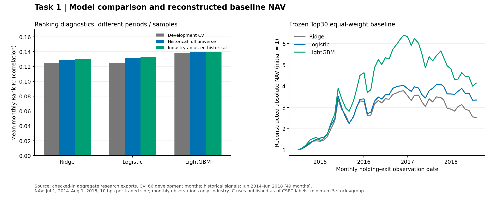
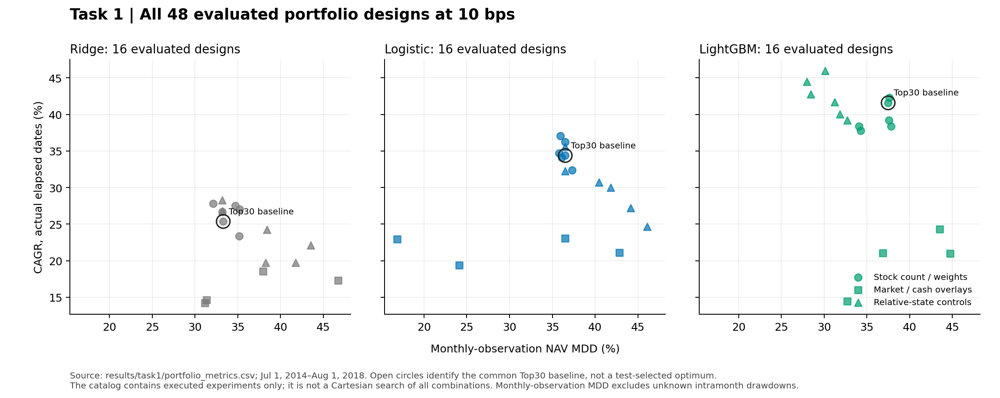
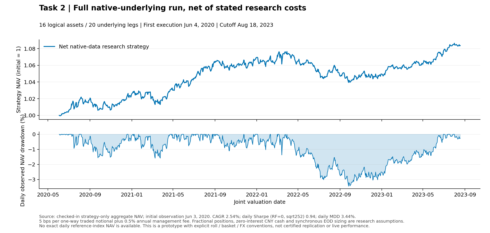

# Historical research results and backtests

This page retains the complete historical performance and risk evidence for both projects. All charts below come from the public aggregate CSVs. They are historical-data research simulations under declared assumptions, not generated-price demos or live trading records.

[Project overview](../README.md) · [Result definitions and code mapping](../docs/results_guide.md) · [Metric dictionary](../docs/data_dictionary.md) · [Data access](../docs/data_access.md)

## Task 1 — Stock ranking and portfolio results

The source panel covers January 2005–June 2018. Development spans 113 signal months, with 66 validation months across three expanding folds. The subsequent 49 evaluation signal months are June 2014–June 2018; the matched investment intervals run July 1, 2014–August 1, 2018.

Mean full-universe evaluation Rank IC is **0.1281 for Ridge**, **0.1312 for Logistic** and **0.1399 for LightGBM**. LightGBM is the model selected by development-validation IC. On the identical classified sample, industry adjustment changes its mean IC from **0.1402 to 0.1399**. These statistics address prediction ranking, not prediction accuracy or the profitability of an executable investment product.

For the common Top30 equal-weight, long-only baseline, net of a hypothetical **10 bps per traded side**:

- **Ridge:** CAGR **25.37%**; Sharpe **0.706**; monthly-observation NAV MDD **33.30%**.
- **Logistic:** CAGR **34.38%**; Sharpe **0.911**; monthly-observation NAV MDD **36.51%**.
- **LightGBM:** CAGR **41.59%**; Sharpe **0.965**; monthly-observation NAV MDD **37.49%**.

NAV is reconstructed from the supplied arithmetic stock-minus-CSI300 return field and the matching CSI300 price return. Its MDD is observed only at the monthly holding boundaries. These large historical returns and concentrated-portfolio drawdowns must be read together. Target-weight cost estimates omit holding drift, spreads, impact and trading constraints.

### All portfolio configurations

The catalog retains **48 unique configurations × 4 cost assumptions = 192 rows**. It covers Top30/50/100, equal/risk-rank weights, four market/cash overlays and six relative-state controls per model. It does not invent unrun joint combinations or select a new strategy from later performance.

Stronger full-universe IC did not automatically lead to lower concentrated-portfolio risk. Some risk controls reduced a historical drawdown while sacrificing return or failing the declared development criterion. The complete catalog preserves those comparisons.

- [All portfolio metrics](task1/portfolio_metrics.csv)
- [Model selection and comparison](task1/model_comparison.csv) and [18-configuration CV leaderboard](task1/cv_leaderboard.csv)
- [Baseline monthly returns](task1/monthly_baseline_returns.csv) and [NAVs](task1/monthly_baseline_nav.csv)
- [All 48 FF3/FF5 attributions at 10 bps](task1/factor_attribution.csv)
- [Industry monthly IC](task1/industry_monthly_ic.csv), [coverage](task1/industry_coverage.csv), [HAC inference](task1/industry_inference.csv) and [block bootstrap](task1/industry_bootstrap.csv)
- [Full summary](task1/summary.json), [code correspondence checks](task1/portable_code_verification.json) and [methodology](../docs/task1_methodology.md)

## Task 2 — Native multi-asset backtest

The complete run uses **16 logical exposures and 20 actual underlying legs**. Following native-observation warm-up, initial NAV is dated June 3, 2020, first execution is June 4, 2020, and the evaluation ends August 18, 2023. The account has **836 daily return observations**.

Net full-window results:

- **CAGR:** 2.5388%; **cumulative return:** 8.3697%.
- **Annualized daily volatility:** 2.6197%.
- **Daily Sharpe:** 0.9380, using RF=0 and the declared sqrt(252) convention.
- **Daily NAV MDD:** 3.4408%, from March 30 to September 26, 2022.

The model charges **5 bps per one-way traded notional** and an **annual 0.5% management fee** accrued over calendar time. Funded equity indices exclude dividends. Futures contribute held-contract variation margin, with roll trades and FX conversion treated explicitly. Fractional quantities, zero-interest CNY cash and synchronous end-of-day sizing are research assumptions; margin calls, collateral interest, whole-contract execution and market impact are not simulated.

The fixed January 2021–cutoff window and partial-year results remain available alongside the complete run. No exact daily reference-index NAV was available, so an exact reference Sharpe/MDD comparison is not reported. This is a fixed-rule historical study, not an untouched OOS or live record.

- [Both performance windows](task2/performance.csv)
- [Daily NAV and drawdown](task2/strategy_nav.csv), [monthly returns](task2/monthly_returns.csv) and [yearly returns](task2/yearly_returns.csv)
- [Logical-to-underlying universe](task2/universe.csv)
- [Full summary](task2/summary.json), [accounting verification](task2/verification_summary.json), [public-code correspondence](task2/portable_code_verification.json) and [methodology](../docs/task2_methodology.md)

## Reading the results

Task 1 and Task 2 have different data frequencies, accounting conventions and risk-free assumptions. Monthly Task 1 drawdown cannot recover intramonth losses and should not be compared directly with daily Task 2 drawdown.

The evaluation history has been examined repeatedly. Statistical associations and factor-model intercepts do not establish deployable alpha without further unseen data, source-timing checks and realistic execution analysis. Raw source data, individual stock predictions, holdings, vendor files and private documents are not included.

All statistical/backtest figures can be regenerated from these public aggregates with `python docs/figures/regenerate.py`. The optional `--demo` commands use separately generated inputs and do not reproduce the historical performance above.
